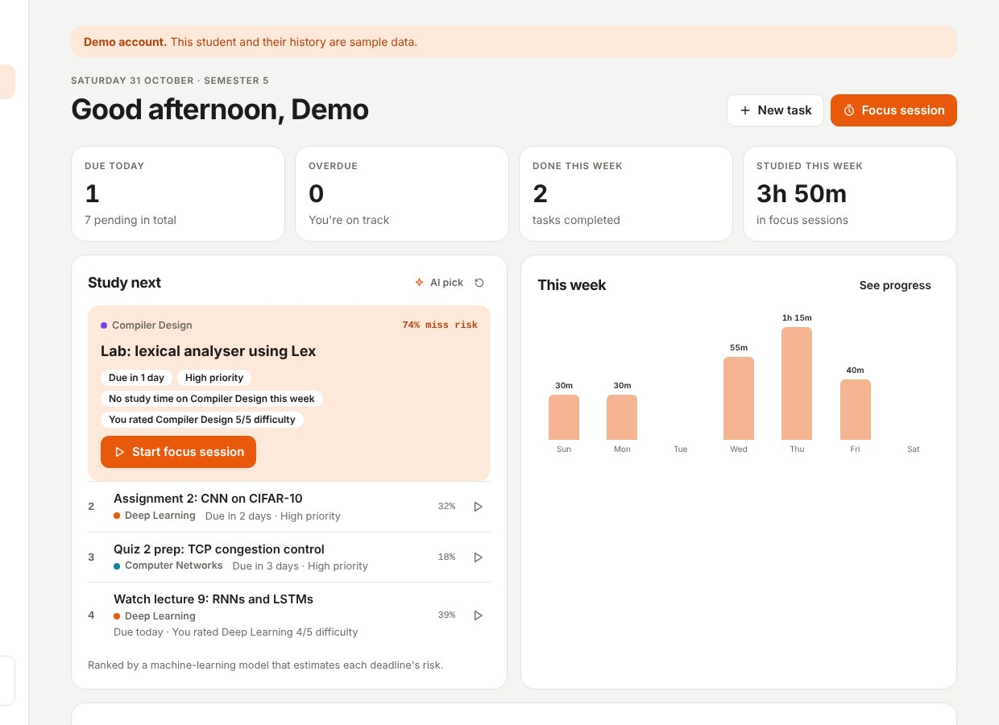
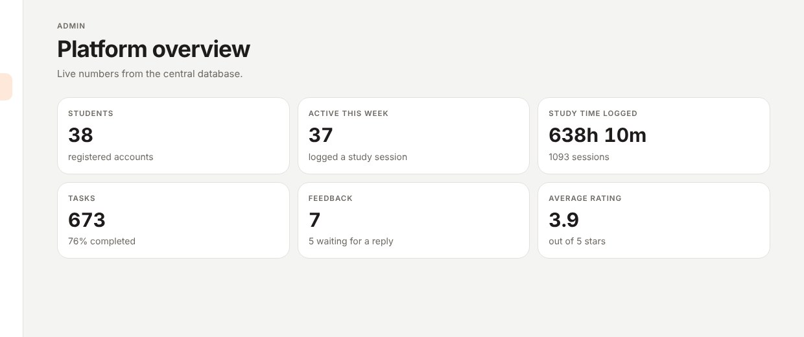
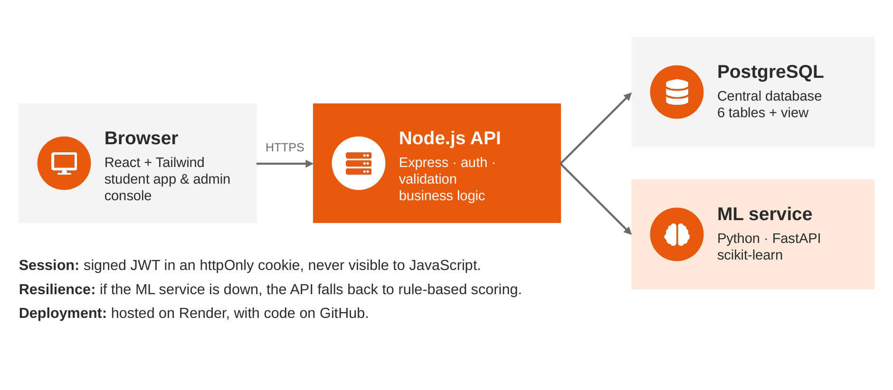
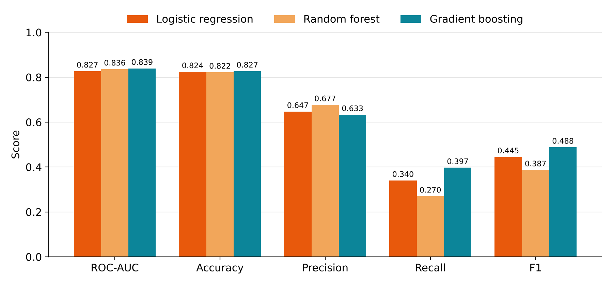

# Mentora

**An AI-powered study planner that tells students what to study next, and why.**

Mentora brings subjects, tasks, focus sessions and progress tracking into one web app. A machine-learning model predicts which deadlines a student is at risk of missing, then ranks their pending tasks and explains each recommendation.




---

## Features

### For students
- **Email and password sign-in**: bcrypt-hashed passwords and a JWT session in an httpOnly cookie
- **Subjects**: credits, plus how hard each subject is for you (1–5)
- **Tasks**: due date, priority and estimated effort
- **Focus timer**: 25- or 50-minute sessions linked to a subject and task
- **Study next (AI)**: pending tasks ranked by predicted risk of missing the deadline, with the reasons shown
- **Progress**: completion and on-time rate, study streak, a 30-day chart and a per-subject breakdown
- **Feedback**: send feedback and see the admin's reply in the app
- **Light and dark theme**, responsive on phones

### For admins
- **Overview**: students, activity, study time and feedback at a glance
- **Users**: search, disable or delete accounts
- **Feedback inbox**: reply to students
- **AI model**: metrics, feature weights, algorithm comparison, one-click retraining and K-Means learner segments



---

## Tech stack

| Layer | Technology |
|---|---|
| Frontend | React, Tailwind CSS (Vite) |
| Backend | Node.js 20, Express (REST API) |
| Database | PostgreSQL 14+ |
| Authentication | Email + password, bcrypt, JWT in an httpOnly cookie |
| ML service | Python, FastAPI, scikit-learn, pandas, NumPy |
| Deployment & tools | Render, Git & GitHub, VS Code |

## Architecture



```
Browser (React)  →  Node.js / Express API  →  PostgreSQL
                              ↓
                    Python ML service (FastAPI + scikit-learn)
```

- Only the API talks to the database. Every query is filtered by the signed-in user.
- If the ML service is down, the API falls back to a rule-based score, so students are never blocked.

---

## How the AI works

**Problem.** For each pending task, predict the probability that its deadline will be missed.

**Features**
- days left
- hours per day needed
- estimated effort
- priority
- subject difficulty
- study time on the subject in the last 7 days
- the student's on-time history
- number of pending tasks

**Data.** A new app has no history (the cold-start problem), so the model starts from 6,000 simulated tasks from 400 simulated students. The admin can retrain it on real outcomes from the database, with real rows weighted 3×.

**Model selection** (5-fold cross-validation, 6,528 examples):

| Algorithm | ROC-AUC | Accuracy | F1 |
|---|---|---|---|
| **Logistic regression (selected)** | **0.827** | **0.824** | **0.445** |
| Random forest | 0.836 | 0.822 | 0.387 |
| Gradient boosting | 0.839 | 0.827 | 0.488 |

Logistic regression is within 0.012 AUC of the best model, and each prediction splits exactly into per-feature contributions. Those contributions become the reasons students see, such as *"Due in 1 day"* or *"No study time on this subject this week"*.

**Ranking:** `score = 0.55 × risk + 0.25 × priority + 0.20 × urgency`

**Segmentation:** K-Means (k = 3) groups students into consistent planners, irregular studiers and students who need support.



> These results come from simulated and demo data. A pilot with real students is the next step.

---

## Project structure

```
mentora-app/
├── client/        React + Tailwind app (pages/, components/, context/)
├── server/        Express API (routes/, services/, db/schema.sql), tests/
├── ml/            FastAPI ML service (app.py, model.py, synthetic.py), tests/
└── render.yaml    Render Blueprint (database + ML service + web app)
```

---

## Getting started

**Requirements:** Node.js 20+, Python 3.10+, PostgreSQL 14+.
On a Mac, [Postgres.app](https://postgresapp.com) is the easiest way to run PostgreSQL.

### 1. Create the database
```bash
createdb mentora
```

### 2. Start the ML service (terminal 1)
```bash
cd ml
python3 -m venv .venv
source .venv/bin/activate          # Windows: .venv\Scripts\activate
pip install -r requirements.txt
uvicorn app:app --port 8000
```

### 3. Start the API (terminal 2)
```bash
cd server
cp .env.example .env               # set DATABASE_URL for your PostgreSQL
npm install
npm run seed                       # optional: demo students and data
npm run dev                        # http://localhost:4000
```

### 4. Start the React app (terminal 3)
```bash
cd client
npm install
npm run dev                        # open http://localhost:5173
```

### Demo accounts (after `npm run seed`)
| Role | Email | Password |
|---|---|---|
| Student | demo@mentora.app | Demo@1234 |
| Admin | admin@mentora.app | Admin@12345 |

### Environment variables (`server/.env`)
| Variable | Purpose |
|---|---|
| `PORT` | API port (default 4000) |
| `DATABASE_URL` | PostgreSQL connection string |
| `JWT_SECRET` | Secret used to sign session tokens |
| `ML_URL` | ML service address (default `http://localhost:8000`) |
| `ADMIN_EMAIL`, `ADMIN_PASSWORD` | First admin account, created on start-up |

> Change the admin password and `JWT_SECRET` before deploying.

---

## Deploy on Render
1. Push this repository to GitHub.
2. On [render.com](https://render.com), choose **New → Blueprint** and select the repository. Render reads `render.yaml` and creates the database, the ML service and the web app.
3. Enter `ADMIN_EMAIL` and `ADMIN_PASSWORD` when asked, then wait for the build to finish.
4. Optional: load the demo data from the web service's **Shell** with `cd server && node src/db/seed-demo.js`.

Free instances sleep after 15 minutes idle and take about a minute to wake.

---

## Tests
```bash
cd server && npm test              # needs a database named mentora_test
cd ml && python -m unittest
```

The API tests run real HTTP requests against a PostgreSQL test database. They cover:
- sign-in
- data privacy between students
- admin access
- feedback replies
- disabled accounts
- AI ranking
- the ML-down fallback

The ML tests check model accuracy, risk ordering and K-Means segmentation.

---

## Roadmap
- [ ] Pilot with real students (on-time rate before vs after)
- [ ] Email verification and password reset
- [ ] Calendar sync and deadline reminders
- [ ] Quiz and flashcard generation from notes
- [ ] Spaced-repetition revision scheduling
- [ ] Installable mobile app (PWA)

---

## Team
Built as a **PBL-III** project, B.Tech CSE (AI & ML), **Manipal University Jaipur**.

- **Aahana Roy**
- **Lavanya Agnihotri**
- Guide: **Dr. Shinnu Jangra**
